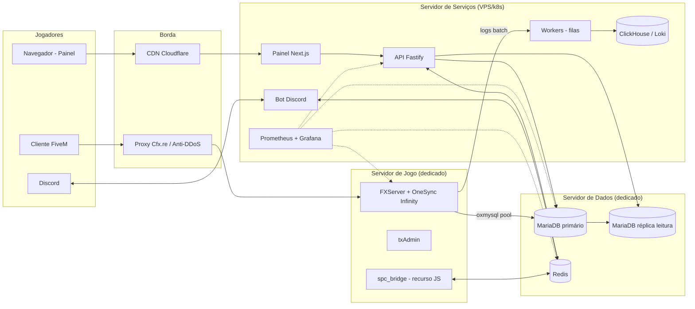

# 01 — Arquitetura

**Status:** EM REVISÃO · **Versão:** 0.1 · **Dono:** CTO

---

## 1. Decisões de stack (ADRs iniciais)

| ADR | Decisão | Motivo | Alternativas descartadas |
|-----|---------|--------|--------------------------|
| ADR-001 | **FiveM + OneSync Infinity** | Única plataforma madura para RP em GTA V com 500+ slots | RageMP (ecossistema menor), alt:V (descontinuado) |
| ADR-002 | **Core próprio `spc_core`** sobre o ecossistema **Overextended** (`ox_lib`, `oxmysql`, `ox_inventory`, `ox_target`) | Controle total de economia, permissões e performance; ox é o stack mais performático e mantido | ESX (legado, lento), QBCore (acoplado), QBox puro (bom, mas queremos dono do core) |
| ADR-003 | **Lua 5.4** para recursos de jogo | Melhor performance no runtime do FiveM, ecossistema | JS/C# no jogo (só onde necessário, ex.: ponte Redis) |
| ADR-004 | **TypeScript (Node 22 LTS)** para API, bot e painel | Tipagem compartilhada, um único time web | Python/Go (dividiria o time) |
| ADR-005 | **MariaDB 11 LTS** (InnoDB) como banco principal | Compatível com `oxmysql`, performance, replicação simples | PostgreSQL (sem driver maduro para o jogo) |
| ADR-006 | **Redis 7** para cache, pub/sub e filas | Comunicação jogo ↔ API ↔ bot em tempo real | RabbitMQ (complexidade desnecessária na fase 1) |
| ADR-007 | **ClickHouse** (ou Loki) para logs de alto volume | Logs não pesam no banco transacional; consultas analíticas rápidas | Logs no MariaDB (degrada o jogo), webhooks Discord (rate limit) |
| ADR-008 | **Next.js 15 + Fastify** para painel e API | SSR para painel, API rápida e separada | Monólito Express |
| ADR-009 | **Monorepo (pnpm + Turborepo)** | Tipos e constantes compartilhados entre API, bot, painel | Multi-repo |
| ADR-010 | **pma-voice** (Mumble nativo do FiveM) | Gratuito, estável em alta população, rádio e telefone | SaltyChat (exige TeamSpeak + plugin) |

## 2. Topologia



### Princípios

1. **O servidor de jogo só fala com MariaDB e Redis.** Nunca chama HTTP externo no caminho crítico.
2. **Painel e bot nunca escrevem direto em tabelas "quentes" do jogo** (inventário, dinheiro) enquanto o
   jogador está online. Eles publicam um **comando** no Redis; o `spc_bridge` executa no jogo, que é a
   autoridade. Se o jogador está offline, a API escreve no banco usando o mesmo serviço de ledger.
3. **Leituras analíticas vão para a réplica.** Primário é reservado ao jogo.
4. **Logs saem do jogo em lote** (a cada 2 s ou 500 eventos) para a fila → ClickHouse.

## 3. Hardware de referência (500–700 jogadores)

| Máquina | Especificação mínima | Observação |
|---------|---------------------|------------|
| **Jogo** | CPU com altíssimo *single-thread* (ex.: Ryzen 9 9950X / 7950X), 64 GB DDR5, NVMe Gen4, 1–10 Gbps, **datacenter em São Paulo** com mitigação DDoS | O *server thread* do FXServer é majoritariamente single-thread: clock importa mais que núcleos |
| **Dados** | 8–16 núcleos, 64 GB RAM, NVMe em RAID1, rede privada com o servidor de jogo (< 1 ms) | `innodb_buffer_pool_size` ≈ 70% da RAM |
| **Serviços** | 4–8 vCPU, 16 GB RAM (ou cluster k8s pequeno) | Escala horizontal |
| **Backup** | Armazenamento externo (S3 compatível) em outra região | Criptografado |

## 4. Estratégia de escala para 500+ jogadores

### 4.1 Orçamentos de performance (obrigatórios)

| Métrica | Orçamento |
|---------|-----------|
| Recurso cliente — idle (`resmon`) | ≤ 0,05 ms |
| Recurso cliente — ativo | ≤ 0,30 ms |
| Recurso servidor — média | ≤ 0,50 ms por tick |
| Soma do *server thread* em pico | < 35% |
| Query de jogo p95 | < 15 ms |
| Eventos rede por jogador | ≤ 30/s (rate limit acima disso) |
| Asset streamado (veículo) | ≤ 16 MB por modelo, texturas ≤ 2048² |

### 4.2 Técnicas obrigatórias

- **OneSync Infinity** com `sv_entityLockdown strict` (cliente não cria entidades em rede sem permissão).
- **State bags** em vez de eventos para estado replicado (ex.: `Player(src).state.job`).
- **Sem loops `Wait(0)`** exceto quando estritamente necessário (desenho de marcador próximo); usar
  `ox_lib` zonas/pontos com *distance check* e `ox_target`.
- **Cache em memória** no servidor de tudo que é lido com frequência (itens, preços, cargos); invalidação via Redis.
- **Escrita em lote**: posições, fome/sede, estatísticas salvas a cada 5 min e no *drop*; nunca por tick.
- **Routing buckets** para interiores instanciados (casas, testes do DETRAN, prisão especial).
- **Pool de veículos NPC reduzido** (densidade 0,3–0,5) e limpeza de veículos abandonados a cada 30 min.
- **Streaming**: MLOs com LOD; auditoria de tamanho de assets no CI; limite de *assets* totais por área.
- **Eventos com payload mínimo**; nunca enviar tabelas inteiras ao cliente.
- **Callbacks com timeout** (`lib.callback`), sem chamadas síncronas ao banco no tick.

### 4.3 Teste de carga

- Script de jogadores sintéticos (cliente headless não existe → usamos **playtests escalonados**:
  64 → 128 → 256 → 400 → 512) com perfilamento (`profiler record`) em cada etapa.
- Teste de carga sintético da **API e do banco** com k6 simulando 700 jogadores (salvamentos, compras, ledger).
- Nenhum recurso vai para produção sem relatório de perfil anexado ao PR.

## 5. Segurança

| Ameaça | Controle |
|--------|----------|
| Execução de eventos falsos (*trigger event*) | Todo evento servidor valida: origem, permissão, distância, cooldown, estado. Eventos sensíveis usam **callbacks** com validação, nunca `TriggerServerEvent` "confiando" no cliente |
| Spawn de dinheiro/itens | Só `spc_core` altera saldo/itens; API interna não exposta via eventos genéricos; alertas de anomalia (ex.: > R$ 500 mil/h) |
| Injeção SQL | Apenas queries parametrizadas (`oxmysql` com `?`) — regra de lint |
| Executores / menus | Anticheat (server-side + solução de mercado), *entity lockdown*, detecção de teleporte/velocidade/godmode por heurística |
| DDoS | Host com mitigação, proxy Cfx, IP real nunca divulgado |
| Segredos | `.env` fora do repositório, cofre (Doppler/Vault/1Password), rotação trimestral. **Nunca** chave no código |
| Painel web | Login Discord OAuth2, 2FA obrigatório para staff, RBAC, CSRF, rate limit, logs de auditoria |
| Vazamento de código | Repositório privado, lógica sensível sempre server-side, *escrow* da Cfx onde fizer sentido |

## 6. Estrutura do monorepo

```
sp-capital-rp/
├─ game/
│  ├─ server.cfg.example
│  └─ resources/
│     ├─ [ox]/            # dependências Overextended (versões fixadas)
│     ├─ [spc-core]/      # spc_core, spc_bridge, spc_logs, spc_anticheat
│     ├─ [spc-systems]/   # banco, celular, veículos, casas, HUD...
│     ├─ [spc-jobs]/      # empregos
│     ├─ [spc-orgs]/      # polícia, hospital, detran, facções
│     ├─ [spc-maps]/      # MLOs
│     └─ [spc-assets]/    # veículos, roupas
├─ services/
│  ├─ api/                # Fastify
│  └─ workers/            # filas, logs, tarefas agendadas (IPVA, juros, aluguel)
├─ apps/
│  ├─ panel/              # Next.js
│  └─ discord-bot/        # discord.js
├─ packages/
│  ├─ shared/             # tipos, constantes, enums (cargos, itens)
│  └─ db/                 # migrações (versionadas) e seeds
├─ infra/                 # docker-compose, ansible/terraform, grafana dashboards
└─ docs/                  # esta documentação
```

## 7. Comunicação entre camadas

| Origem → Destino | Mecanismo | Exemplo |
|------------------|-----------|---------|
| Cliente → Servidor jogo | `lib.callback` / eventos com validação | Comprar item |
| Servidor jogo → Banco | `oxmysql` (pool 20–40 conexões) | Salvar personagem |
| Servidor jogo ↔ API/Bot | Redis pub/sub via `spc_bridge` (canal `spc:cmd`, `spc:evt`) | Ban pelo painel; aviso "PM entrou em serviço" |
| API → Banco | Prisma/Drizzle (réplica para leitura) | Extrato bancário no painel |
| Jogo → Logs | Buffer → Redis Stream `spc:logs` → worker → ClickHouse | Log de transação |
| Workers agendados | Cron no worker (fora do jogo) | Cobrança de IPVA semanal, juros, aluguel |

### Contrato de comandos (Redis)

```json
{ "id": "uuid", "type": "player.kick", "actor": "staff:123", "payload": { "citizenid": "SPC12345", "reason": "..." }, "ts": 1731240000 }
```
Todo comando tem resposta em `spc:ack:<id>` com sucesso/erro, e é auditado.

## 8. Observabilidade

- **Métricas** (Prometheus): jogadores online, *server thread*, tempo por recurso, latência de query,
  dinheiro emitido/drenado por hora, filas.
- **Dashboards** (Grafana): Técnico, Economia, Staff, Instituições (policiais/médicos em serviço).
- **Alertas** (Discord privado + celular de plantão): tick > 40%, DB p95 > 50 ms, emissão de dinheiro
  anômala, servidor caiu, disco > 80%.
- **Logs** estruturados (JSON) com `citizenid`, `license`, `resource`, `action`, `amount`, `coords`.

## 9. Ambientes

| Ambiente | Uso | Dados |
|----------|-----|-------|
| `dev` | Máquina de cada dev (docker-compose com MariaDB/Redis) | Seeds |
| `staging` | Servidor de testes (64 slots), espelho da produção | Cópia anonimizada |
| `prod` | Cidade | Reais |

Deploy: GitHub Actions → build/lint/test → artefato versionado → `staging` → aprovação → `prod`
em janela de *restart* agendado (ex.: 05:00 e 17:00). Rollback = reimplantar artefato anterior.

## 10. Restarts e continuidade

- Restarts programados 2×/dia com avisos (15, 5, 1 min) — salvamento forçado de todos os jogadores.
- *Graceful shutdown*: bloqueia novas ações econômicas 30 s antes, salva tudo, depois encerra.
- Backups: dump completo diário + binlog contínuo (PITR, recuperação a qualquer minuto em 7 dias).
