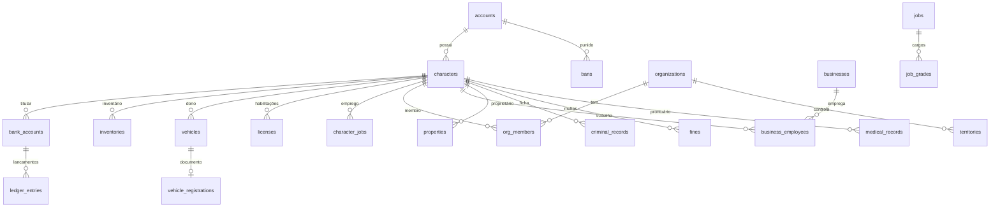

# 02 — Banco de Dados

**Status:** APROVADO · **Versão:** 1.0 · **Dono:** DBA / CTO

---

## 1. Princípios

1. **MariaDB 11 / InnoDB, `utf8mb4`**, fuso UTC no banco (conversão para `America/Sao_Paulo` na exibição).
2. **Dinheiro em centavos** (`BIGINT`), nunca `FLOAT`/`DECIMAL` em cálculo de jogo.
3. **Ledger de dupla entrada**: saldo é derivado e conferível; nenhuma alteração de saldo sem lançamento.
4. **Migrações versionadas** (`packages/db/migrations/NNNN_nome.sql`), nunca alteração manual em produção.
5. **Toda tabela** tem `id` (BIGINT auto ou chave natural), `created_at`, `updated_at`.
6. **Soft delete** (`deleted_at`) para entidades de jogador; *hard delete* apenas por LGPD.
7. **Logs de alto volume não ficam no MariaDB** (vão para ClickHouse — ver arquitetura).
8. **JSON** apenas para metadados flexíveis (aparência, metadados de item), nunca para dados consultados com filtro.

## 2. Diagrama de entidades (núcleo)

## 3. Tabelas

### 3.1 Identidade

**`accounts`** — uma por pessoa real
| Coluna | Tipo | Notas |
|--------|------|-------|
| id | BIGINT PK | |
| license | VARCHAR(64) UNIQUE | Rockstar license |
| discord_id | VARCHAR(32) UNIQUE | Obrigatório (whitelist) |
| steam_id / fivem_id | VARCHAR(64) NULL | Identificadores extras para ban |
| whitelist_status | ENUM('pending','approved','rejected','suspended') | |
| char_slots | TINYINT | Padrão 2 |
| priority | TINYINT | Prioridade de fila (0–100) |
| playtime_minutes | INT | |
| last_login_at, created_at | DATETIME | |

**`characters`**
| Coluna | Tipo | Notas |
|--------|------|-------|
| id | BIGINT PK | |
| citizenid | CHAR(8) UNIQUE | Ex.: `SPC4F2A1` — ID público do personagem |
| account_id | FK accounts | |
| first_name, last_name | VARCHAR(32) | |
| birthdate | DATE | |
| gender | ENUM | |
| nationality | VARCHAR(32) | |
| cpf | CHAR(14) UNIQUE | CPF fictício gerado (formato válido, não real) |
| rg | VARCHAR(12) UNIQUE | |
| phone_number | VARCHAR(16) UNIQUE | Formato `(11) 9XXXX-XXXX` |
| appearance | JSON | Roupas/rosto (ox/illenium appearance) |
| position | JSON | `{x,y,z,h}` salvo em lote |
| status | JSON | Fome, sede, stress, armadura |
| is_dead | BOOLEAN | |
| jail_minutes | INT | Pena restante |
| ck_at | DATETIME NULL | Morte permanente |
| deleted_at | DATETIME NULL | |

### 3.2 Economia

**`bank_accounts`**
| Coluna | Tipo | Notas |
|--------|------|-------|
| id | BIGINT PK | |
| number | VARCHAR(12) UNIQUE | Agência-conta |
| owner_type | ENUM('character','business','organization','government') | |
| owner_id | BIGINT | |
| kind | ENUM('checking','savings','salary','business','dirty') | `dirty` = dinheiro sujo (só orgs) |
| balance | BIGINT | Cache do saldo (centavos) — reconciliado com ledger diariamente |
| pix_key | VARCHAR(64) UNIQUE NULL | |
| frozen | BOOLEAN | Bloqueio judicial |

**`ledger_entries`** (particionada por mês)
| Coluna | Tipo | Notas |
|--------|------|-------|
| id | BIGINT PK | |
| tx_id | CHAR(26) | ULID da transação (agrupa débito + crédito) |
| account_id | BIGINT NULL | NULL = conta de sistema |
| system_account | VARCHAR(32) NULL | `MINT_SALARY`, `SINK_TAX`, `SINK_SHOP` ... |
| amount | BIGINT | Positivo = crédito, negativo = débito |
| balance_after | BIGINT | |
| reason | VARCHAR(48) | Código padronizado (`job.pay`, `shop.buy`, `fine.pay`) |
| ref_type, ref_id | VARCHAR(32), BIGINT | Referência ao objeto (multa, compra) |
| actor | VARCHAR(48) | `char:SPC4F2A1`, `staff:12`, `system` |
| created_at | DATETIME(3) | |

> **Invariante:** para cada `tx_id`, `SUM(amount)` = 0 considerando as contas de sistema.
> Emissão (*mint*) e destruição (*sink*) de dinheiro aparecem como contas de sistema, o que permite
> medir exatamente quanto dinheiro entrou e saiu da economia.

**`cash`**: dinheiro em espécie é um **item** do inventário (`money`), roubável e transferível fisicamente.
Dinheiro sujo é o item `dirty_money`.

### 3.3 Inventário e itens

**`items`** (definições — também em arquivo versionado, carregadas em cache)
| name PK | label | weight | stackable | max_stack | category | base_price | legal |

**`inventories`**
| Coluna | Tipo | Notas |
|--------|------|-------|
| id | VARCHAR(64) PK | `char:SPC4F2A1`, `trunk:ABC1D23`, `stash:house:12`, `org:7` |
| owner | VARCHAR(64) | |
| slots | JSON | Gerenciado pelo `ox_inventory` |
| max_weight | INT | |

### 3.4 Empregos

- **`jobs`** (`name`, `label`, `type` = `legal|gov|org`, `whitelisted`, `max_on_duty`)
- **`job_grades`** (`job_name`, `grade`, `label`, `salary`, `permissions JSON`)
- **`character_jobs`** (`character_id`, `job_name`, `grade`, `is_primary`, `hired_at`)
- **`job_sessions`** (`character_id`, `job_name`, `on_duty_at`, `off_duty_at`, `earned`) — "bater ponto"
- **`job_progress`** (`character_id`, `job_name`, `xp`, `level`, `tasks_done`)

### 3.5 Veículos e DETRAN

**`vehicles`**
| id | owner_type/owner_id | model | plate UNIQUE (`ABC1D23`) | garage | state ENUM('garage','out','impound','destroyed','seized') | fuel | engine | body | mods JSON | mileage_km |

**`vehicle_registrations`**: `vehicle_id`, `renavam` UNIQUE, `crlv_valid_until`, `ipva_paid_until`, `insurance_until`, `stolen` BOOLEAN.

**`licenses`**: `character_id`, `type` (`cnh_a`, `cnh_b`, `cnh_c`, `cnh_d`, `cnh_e`, `porte_arma`, `pesca`, `caca`, `piloto`), `status` (`active`,`suspended`,`revoked`), `points`, `issued_at`, `expires_at`.

**`driving_exams`**: `character_id`, `type`, `stage` (`theory`,`practical`), `score`, `passed`, `examiner_id NULL`.

**`impounds`**: `vehicle_id`, `reason`, `officer_id`, `fee`, `released_at`.

### 3.6 Polícia e Justiça

- **`criminal_records`**: `character_id`, `case_id`, `charges JSON` (códigos do código penal da cidade), `sentence_months`, `fine`, `officer_id`, `status`.
- **`police_reports`** (boletins de ocorrência): `number`, `reporter_id`, `type`, `description`, `involved JSON`, `status`.
- **`warrants`**: `character_id`, `type` (`prisao`,`busca`), `judge_id`, `reason`, `expires_at`, `active`.
- **`fines`**: `character_id`, `vehicle_id NULL`, `code`, `amount`, `points`, `due_at`, `paid_at`, `issuer_id`.
- **`evidence`**: `case_id`, `type` (`capsula`,`sangue`,`digital`,`foto`,`video`), `metadata JSON`, `collected_by`, `chain JSON` (cadeia de custódia).
- **`court_cases`**: `number`, `type`, `judge_id`, `prosecutor_id`, `defense_id`, `status`, `verdict`.

### 3.7 Hospital

- **`medical_records`**: `character_id`, `doctor_id`, `injuries JSON`, `treatment`, `cost`, `created_at`.
- **`health_plans`**: `character_id`, `tier`, `valid_until`.

### 3.8 Organizações (facções legais e ilegais)

- **`organizations`**: `name`, `label`, `type` (`gang`,`mafia`,`mc`,`cartel`,`hackers`,`legal`), `color`, `max_members`, `reputation`, `bank_account_id`, `dirty_account_id`, `status`.
- **`org_members`**: `org_id`, `character_id`, `rank`, `joined_at`.
- **`org_ranks`**: `org_id`, `rank`, `label`, `permissions JSON`.
- **`territories`**: `name`, `zone JSON` (polígono), `org_id NULL`, `influence JSON` (`{org_id: 0-100}`), `contested_until`.
- **`org_wars`**: `attacker_id`, `defender_id`, `declared_at`, `starts_at`, `ends_at`, `rules JSON`, `result`.

### 3.9 Empresas e imóveis

- **`businesses`**: `name`, `type`, `owner_id`, `cnpj` (fictício), `license_status`, `bank_account_id`, `stock_inventory_id`, `location JSON`, `tax_regime`.
- **`business_employees`**: `business_id`, `character_id`, `role`, `wage_per_hour`.
- **`business_sales`** (particionada): `business_id`, `item`, `qty`, `price`, `buyer_id NULL`, `created_at`.
- **`properties`**: `type` (`apartment`,`house`,`warehouse`,`commercial`), `label`, `price`, `owner_id NULL`, `rent_price`, `iptu_paid_until`, `stash_id`, `interior`, `locked`.
- **`property_keys`**: `property_id`, `character_id`.

### 3.10 Celular

- **`phone_contacts`**, **`phone_messages`** (particionada por mês), **`phone_calls`**, **`phone_social_posts`**, **`phone_bank_pix`** (espelho de leitura do ledger).

### 3.11 Staff e moderação

- **`staff`**: `account_id`, `role` (`helper`,`mod`,`admin`,`head`,`dev`,`owner`), `totp_secret` (criptografado).
- **`bans`**: `account_id`, `identifiers JSON` (license, discord, steam, tokens de hardware), `reason`, `staff_id`, `expires_at NULL`, `revoked_at`.
- **`warnings`**: `account_id`, `reason`, `staff_id`, `points`.
- **`whitelist_applications`**: `discord_id`, `answers JSON`, `status`, `reviewer_id`, `interview_at`.
- **`tickets`**: `discord_channel_id`, `account_id`, `category`, `status`, `assigned_staff_id`.
- **`audit_log`** (somente ações de staff/admin — volume baixo, fica no MariaDB): `staff_id`, `action`, `target`, `before JSON`, `after JSON`, `ip`, `created_at`.

## 4. Índices essenciais

| Tabela | Índice | Motivo |
|--------|--------|--------|
| characters | `(account_id)`, `UNIQUE(citizenid)`, `UNIQUE(phone_number)` | Login, ligações |
| ledger_entries | `(account_id, created_at)`, `(tx_id)`, `(reason, created_at)` | Extrato, auditoria, dashboards |
| vehicles | `UNIQUE(plate)`, `(owner_type, owner_id)`, `(state)` | Consulta MDT/garagem |
| fines | `(character_id, paid_at)` | Multas em aberto |
| org_members | `UNIQUE(character_id)` | Um personagem → uma organização ilegal |
| phone_messages | `(conversation_id, created_at)` | Paginação |
| bans | `(account_id)`, índices virtuais em `identifiers` | Verificação de conexão |

## 5. Padrões de acesso

- **Login:** 1 query de conta + 1 de personagens → cache em memória durante a sessão.
- **Durante a sessão:** leituras do cache; escritas críticas (dinheiro, itens) **imediatas e transacionais**;
  não críticas (posição, status) **em lote a cada 5 min**.
- **Transação financeira:** `START TRANSACTION` → `SELECT ... FOR UPDATE` nas contas envolvidas
  (ordenadas por id para evitar *deadlock*) → inserir lançamentos → atualizar saldos → `COMMIT`.
- **Idempotência:** toda operação financeira carrega `tx_id`; reprocessar o mesmo `tx_id` não duplica.

## 6. Dimensionamento (estimativa 500 CCU, ~8.000 contas ativas/mês)

| Tabela | Linhas/dia | Retenção no MariaDB |
|--------|-----------|----------------------|
| ledger_entries | ~1,5 mi | 12 meses (partições antigas → arquivo frio) |
| phone_messages | ~400 mil | 90 dias |
| business_sales | ~200 mil | 6 meses |
| Logs de gameplay | ~10 mi | **ClickHouse**, 180 dias |

## 7. Backup e recuperação

- `mariabackup` completo diário (03:00) + binlog contínuo → armazenamento externo criptografado.
- **RPO:** ≤ 1 min · **RTO:** ≤ 30 min.
- Teste de restauração **mensal** obrigatório em `staging`.
- Reconciliação diária: `balance` de cada conta = soma do ledger; divergência gera alerta crítico.

## 8. LGPD

- Dados pessoais reais armazenados: apenas `discord_id`, identificadores de jogo, IP (logs de segurança, 90 dias).
- Nada de nome real, CPF real, telefone real.
- Pedido de exclusão: anonimiza `accounts` e personagens em até 15 dias; mantém registros de ban
  (legítimo interesse) apenas com hash dos identificadores.
- Política de privacidade publicada no site e no Discord.
