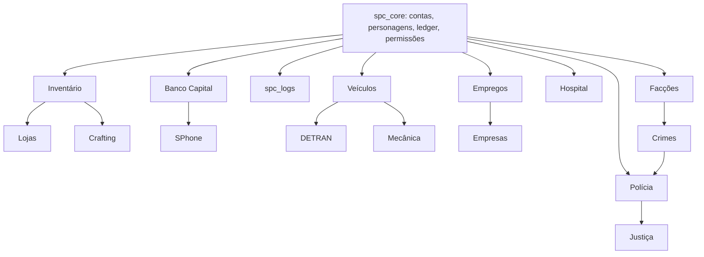

# 03 — Catálogo de Sistemas

**Status:** APROVADO · **Versão:** 1.0 · **Dono:** Lead Developer

Cada sistema listado aqui terá sua própria **spec detalhada** (`docs/specs/<sistema>.md`) antes de ser
implementado, seguindo o modelo em [13-processo-desenvolvimento.md](13-processo-desenvolvimento.md).

Prioridade: **P0** = necessário para alpha · **P1** = necessário para lançamento · **P2** = pós-lançamento.

---

## 1. Núcleo (`[spc-core]`)

| Sistema | Recurso | Prio | Descrição | Pontos críticos |
|---------|---------|------|-----------|-----------------|
| Conexão & fila | `spc_queue` | P0 | Verifica whitelist/ban via cache, fila com prioridade, *deferrals* com cartão adaptativo | Nunca consultar Discord API na conexão (usar cache sincronizado pelo bot) |
| Contas & personagens | `spc_core` | P0 | Multipersonagem, criação (nome, nascimento, CPF/RG gerados), seleção, spawn | Validação de nome (anti-troll), slots por conta |
| Permissões | `spc_core` | P0 | ACE + cargos internos; grupos `staff.*`, `job.*`, `org.*` | Checagem sempre server-side |
| Ledger/Dinheiro | `spc_core` | P0 | API única `Money.transfer(from, to, amount, reason, ref)` | Transacional, idempotente, logado |
| Logs | `spc_logs` | P0 | Buffer → Redis Stream → ClickHouse | Nunca bloquear o tick |
| Ponte externa | `spc_bridge` | P0 | Redis pub/sub para API e bot | Autenticação de comandos, *ack* |
| Anticheat | `spc_anticheat` | P0 | Heurísticas server-side: teleporte, velocidade, godmode, armas não registradas, spam de eventos | Falsos positivos → alerta, não ban automático (exceto casos certos) |
| Admin in-game | `spc_admin` | P0 | Noclip, spectate, tp, reviver, kick/ban, ver inventário — tudo auditado | Ações exigem motivo; staff "em serviço" visível |

## 2. Base de gameplay (`[spc-systems]`)

| Sistema | Prio | Descrição |
|---------|------|-----------|
| **Inventário** (`ox_inventory` customizado) | P0 | Peso, slots, metadados (número de série de armas, validade de comida), porta-malas, porta-luvas, baús, revista policial |
| **HUD** | P0 | Vida, colete, fome, sede, stress, voz, rádio, velocímetro, combustível, cinto, bússola com nome de rua — NUI leve (atualiza só em mudança) |
| **Voz** (`pma-voice`) | P0 | Proximidade (3 alcances), rádio por frequência (frequências 1–10 restritas a governo), telefone, megafone em viaturas |
| **Necessidades** | P0 | Fome, sede, stress; decaimento lento (fome zera em ~3 h reais); stress alto = tremor de mira |
| **Morte & ferimentos** | P0 | Ver [09-hospital.md](09-hospital.md) |
| **Aparência** | P0 | Criador de personagem, lojas de roupa, barbearia, tatuagem, salvamento de "outfits" |
| **Banco Capital** | P0 | Agências, caixas eletrônicos, PIX, extrato, transferências, empréstimos (P1), cartão de débito (item) |
| **Celular "SPhone"** | P0 | Ligações, SMS/WhatsApp-like ("Zap"), contatos, banco, câmera, rede social ("Chirp"), anúncios classificados ("OLX-like" → "Desapega"), GPS, app de empregos, app de táxi/entrega, Dark web (apenas com item específico) |
| **Veículos** | P0 | Chaves (item), trancas, combustível (postos), dano realista leve, cinto, limitador, garagens públicas/privadas, pátio |
| **Concessionárias** | P1 | Popular, intermediária, luxo, motos, caminhões, barcos, aeronaves (com licença) |
| **Mecânica** | P1 | Reparo, tunagem (estética e desempenho), peças como itens, guincho |
| **Imóveis** | P1 | Compra/aluguel, instanciado por *routing bucket*, chaves compartilhadas, baú, decoração (P2) |
| **Lojas** | P0 | Mercadinho, posto, padaria, loja de armas (com porte), ferramentas, eletrônicos |
| **Target/Interação** (`ox_target`) | P0 | Olhar e interagir com NPCs, objetos, veículos, jogadores |
| **Clima & horário** | P0 | Sincronizado, com eventos (garoa paulistana frequente 😄) |
| **Documentos** | P1 | RG, CNH, porte, crachá — itens físicos com metadados, mostráveis a outros jogadores |
| **Crafting** | P1 | Bancadas legais (mecânica, cozinha) e ilegais (armas, drogas), receitas por nível |
| **Pesca / caça / mineração** | P1 | Atividades de renda baixa e relaxantes |
| **Corridas** | P2 | Legais (autódromo) e ilegais (racha), com apostas |
| **Cassino** | P2 | Fichas, jogos, limites diários (dreno de dinheiro) |
| **Eventos da cidade** | P1 | Ferramenta de staff para eventos (shows, futebol, Carnaval, blitz especial) |

## 3. Crime (`[spc-crime]`)

| Sistema | Prio | Policiais mínimos | Cooldown global |
|---------|------|-------------------|-----------------|
| Furto a pessoa / carteira | P1 | 0 | — |
| Roubo a loja de conveniência | P1 | 2 | 20 min por loja |
| Roubo a residência | P1 | 2 | 30 min por casa |
| Roubo de veículo / desmanche | P1 | 2 | — |
| Roubo a joalheria | P1 | 5 | 2 h |
| Roubo a banco pequeno (agência) | P1 | 6 | 2 h |
| Roubo ao Banco Central | P2 | 10 | 6 h, evento agendado |
| Carro-forte | P2 | 6 | 3 h |
| Tráfico (plantio, processamento, venda) | P1 | variável | — |
| Contrabando de armas | P1 | — | Ver [06-faccoes.md](06-faccoes.md) |
| Lavagem de dinheiro | P1 | — | Ver [05-economia.md](05-economia.md) |
| Sequestro | P2 | 4 | Regras rígidas de RP |
| Hacking (minigame) | P1 | — | Usado em vários roubos |

Todos os crimes geram **alerta de despacho** (com chance e atraso configuráveis) e **evidências**.

## 4. Instituições (`[spc-orgs]`)

| Sistema | Documento |
|---------|-----------|
| Polícia (Polícia Militar da Capital — **PMC**; Polícia Civil da Capital — **PCiv**; Polícia Rodoviária — **PRC**) | [08-policia.md](08-policia.md) |
| Hospital / SAMU / Bombeiros | [09-hospital.md](09-hospital.md) |
| DETRAN | [10-detran.md](10-detran.md) |
| Justiça (juízes, promotores, advogados, cartório) | P1 — spec própria |
| Prefeitura (prefeito eleito, impostos, licenças) | P2 — eleições trimestrais |
| Imprensa ("Jornal da Capital" / Weazel renomeado) | P2 |

## 5. Empregos e Empresas

Ver [04-empregos.md](04-empregos.md) e [07-empresas.md](07-empresas.md).

## 6. Dependências entre sistemas

**Regra:** nenhum sistema acessa tabelas de outro diretamente. Cada sistema expõe **exports** server-side
documentados (ex.: `exports.spc_detran:hasLicense(src, 'cnh_b')`).
