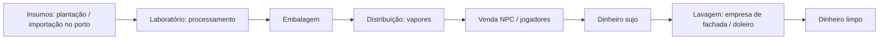

# 06 — Facções e Organizações

**Status:** EM REVISÃO · **Versão:** 0.1 · **Dono:** Head de Staff + Lead Dev

> **Todas as organizações são fictícias.** É proibido criar facções com nome, sigla, símbolo ou
> referência a organizações criminosas reais. Isso protege o servidor juridicamente e no Discord/Twitch.

---

## 1. Tipos de organização

| Tipo | Exemplo fictício | Atividade principal | Máx. membros | Vagas na cidade |
|------|------------------|--------------------|--------------|-----------------|
| **Comunidade / Gangue** | "Bonde da Vila Aurora", "Família Esperança" | Tráfico de rua, territórios, bailes | 25 | 6–8 |
| **Máfia** | "Famiglia Bellucci" | Lavagem, agiotagem, proteção, cassino clandestino | 20 | 2 |
| **Cartel** | "Los Serranos" | Produção em larga escala, rota de importação | 20 | 1–2 |
| **Motoclube** | "Corvos da Estrada MC" | Contrabando de armas, rotas rodoviárias | 20 | 2 |
| **Desmanche** | "Ferro Velho do Zé" | Roubo e desmanche de veículos, peças | 15 | 2 |
| **Hackers** | "NullSP" | Invasões, documentos falsos, apoio a roubos | 8 | 1 |
| **Organizações legais** | Igreja, ONG, torcida organizada fictícia, imprensa | RP social, eventos | 30 | ilimitado (aprovação) |

## 2. Criação e manutenção

1. Proposta via ticket no Discord: nome, lore, liderança, objetivo de RP, membros iniciais (mín. 6).
2. Avaliação da staff (criatividade, histórico dos líderes, vaga disponível).
3. **Período de experiência de 30 dias** com limite reduzido (10 membros, sem guerra).
4. Revisão trimestral: atividade mínima (horas de RP), qualidade de RP, punições.
5. Facção inativa ou com punições graves → rebaixada/desfeita.

## 3. Estrutura interna

- Até 6 cargos configuráveis (ex.: Líder, Sub-líder, Gerente, Soldado, Vapor, Olheiro).
- Permissões por cargo: recrutar, expulsar, acessar baú, acessar dinheiro sujo, declarar guerra, comprar armas.
- **Baú da organização** (inventário compartilhado, com log de quem tirou o quê).
- **Conta de dinheiro sujo** e **conta limpa** (se tiver empresa de fachada).
- **Painel da facção** no painel web: membros, ponto, logs de baú, reputação.

## 4. Territórios

- Mapa dividido em **zonas** (polígonos) — bairros da Zona Leste, Interior, Porto etc.
- Cada zona tem **influência** por organização (0–100).
- Influência sobe com: venda de drogas na zona, presença de membros (limitada), eventos de RP (bailes).
- Influência cai com: apreensões policiais na zona, mortes de membros, inatividade (−2/dia).
- Org com maior influência > 60 **controla** a zona: bônus de preço na venda (+15%), cobrança de
  "taxa" de comércio ilegal, acesso a pontos exclusivos (laboratório, ponto de venda).
- Zonas "seguras" (Centro, hospital, delegacias, DETRAN, prefeitura) não podem ser dominadas.

## 5. Guerras

| Regra | Valor |
|-------|-------|
| Declaração | Pelo painel, pelo líder, com motivo de RP; staff aprova em até 24 h |
| Aviso | Mín. 24 h entre aprovação e início |
| Duração | Até 72 h, em janelas definidas (ex.: 19h–00h) |
| Objetivo | Pontos por controle de zonas contestadas e eliminações *dentro da zona* |
| Limite | Máx. 1 guerra ativa por organização; cooldown de 7 dias após o fim |
| Proibido | Atacar em zona segura, envolver jogadores sem afiliação, *combat logging* |
| Fim | Vencedor ganha influência na zona disputada; perdedor perde 30 de influência |

## 6. Cadeia de suprimento ilegal

- **Armas:** não são vendidas em lojas ilegais NPC. Vêm de **contrabando** (missão do motoclube/cartel
  com risco de interceptação) ou **crafting** com peças raras. Cada arma tem **número de série** —
  armas raspadas são crime adicional.
- **Munição:** item consumível com custo relevante (dreno).
- Quantidades semanais de contrabando são **limitadas pela cidade** (controle de armamento).

## 7. Requisitos para ações criminosas

- Número mínimo de policiais em serviço (ver [03-sistemas.md](03-sistemas.md)).
- Máximo de criminosos por ação (ex.: banco pequeno: 4–6) — evita "exército".
- Negociação obrigatória em ações com refém antes de tiroteio.
- Cooldown por organização após grandes ações (ex.: 24 h após banco).

## 8. Interação com a polícia

- Todo membro de facção ilegal **pode ser investigado**: a Polícia Civil vê no MDT apenas o que foi
  descoberto em RP (nunca a lista oficial de membros).
- Operações policiais em território ganham bônus se baseadas em inquérito com mandado.
- Corrupção policial é permitida **apenas em RP aprovado** pela staff (para evitar desequilíbrio),
  com regras específicas e acompanhamento.

## 9. Punições específicas

| Infração | Punição |
|----------|---------|
| RDM em guerra fora da zona | Advertência à facção + jogador |
| Recrutar menor/novato com < 10 h de cidade | Bloqueado pelo sistema |
| Uso de bug para ganhar território | Perda total de influência + suspensão da facção |
| Apologia a facção real | Dissolução da facção + ban dos responsáveis |
