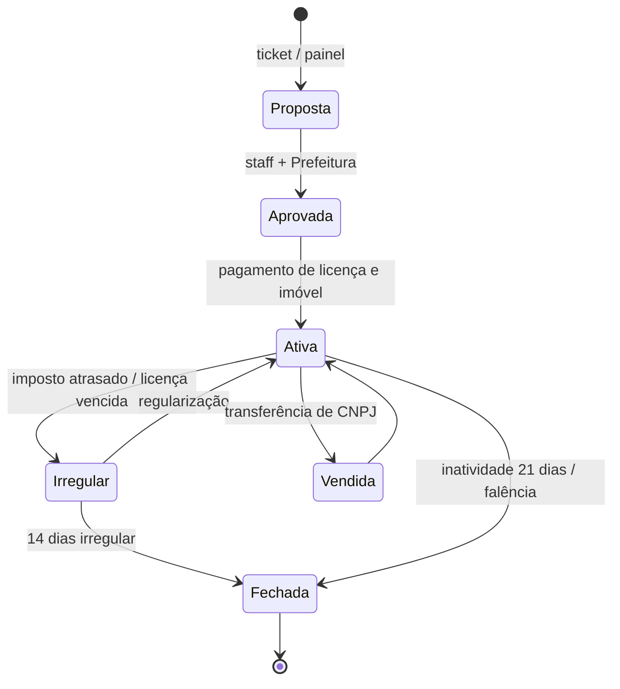

# 07 — Empresas de Jogadores

**Status:** EM REVISÃO · **Versão:** 0.1 · **Dono:** Designer de Economia + Lead Dev

---

## 1. Objetivo

Empresas são o motor da economia **entre jogadores**: geram empregos, serviços e RP social.
Toda empresa tem dono, CNPJ fictício, conta bancária, estoque, funcionários e obrigações fiscais.

## 2. Tipos de empresa

| Tipo | Exemplos | Insumo | Produto/serviço | Vagas |
|------|----------|--------|-----------------|-------|
| **Restaurante / lanchonete** | Pastelaria, pizzaria, churrascaria, açaí, padaria | Ingredientes (agricultor, pescador, atacado NPC) | Comida com buff (stress −) | 8–10 |
| **Bar / casa noturna** | Bar, balada, casa de shows | Bebidas | Bebidas, eventos | 4 |
| **Oficina mecânica** | Oficina, funilaria, tunagem | Peças (mineração/fundição, atacado) | Reparos, tunagem | 4–5 |
| **Concessionária de usados** | Revenda | Veículos de jogadores | Compra/venda com nota | 2 |
| **Imobiliária** | Corretora | — | Comissão sobre venda/aluguel de imóveis de NPC e jogadores | 2 |
| **Transportes** | Táxi, transportadora, guincho | Combustível | Corridas, fretes | 3 |
| **Loja de roupas / tatuagem / barbearia** | — | — | Estética | 4 |
| **Advocacia** | Escritório | OAB (aprovação da Justiça) | Defesa, consultoria | 4 |
| **Segurança privada** | — | Porte | Escolta, segurança de eventos | 2 |
| **Mídia** | Jornal, rádio, agência | — | Publicidade, notícias | 2 |
| **Lavanderia / lava-rápido** | — | — | Fachada clássica 😉 (lavagem regulada) | 3 |

O número de vagas é limitado por tipo para garantir que todas sejam viáveis.

## 3. Ciclo de vida

## 4. Custos de abertura e manutenção (referência)

| Item | Valor |
|------|-------|
| Licença de funcionamento (Prefeitura) | R$ 50.000 – 250.000 conforme tipo |
| Alvará anual (renovação, equivalente a 4 semanas reais) | 20% do valor da licença |
| Imóvel comercial | Compra (R$ 400k–2M) ou aluguel semanal |
| Imposto sobre faturamento | **Simples Capital**: 6% até R$ 500 mil/semana; 11% acima |
| Folha | Definida pelo dono (piso: R$ 3.000/h trabalhada) |

## 5. Operação

- **Estoque**: inventário da empresa; matérias-primas compradas de jogadores (preferência) ou de
  atacado NPC (mais caro, +30%, para garantir funcionamento sem fornecedores).
- **Produção**: funcionários em serviço produzem itens (cozinhar, montar peça) em bancadas.
- **Venda**: balcão (caixa registradora — o cliente paga pelo cartão/espécie), delivery pelo app
  "Rapidinho", ou contrato B2B (ex.: oficina com transportadora).
- **Preço**: o dono define dentro de uma faixa (**50%–300% do preço de referência**) para evitar abuso.
- **NPC cliente**: quando a empresa está aberta e com funcionário em serviço, NPCs compram em pequena
  quantidade (fonte limitada) — garante renda mínima em horários vazios.
- **Ponto eletrônico** e folha automática: pagamento ao funcionário a cada 30 min trabalhado, direto da
  conta da empresa. Conta sem saldo → aviso ao dono → funcionários não são pagos (e podem pedir demissão).

## 6. Painel da empresa (web e tablet in-game)

- Faturamento diário/semanal, estoque, funcionários, ponto, folha, impostos, extrato.
- Contratar/demitir, definir salário e cargos (Dono, Gerente, Funcionário, Estagiário).
- Configurar cardápio/catálogo e preços.

## 7. Regras anti-abuso

| Risco | Regra |
|-------|-------|
| Lavagem descontrolada | Lavagem limitada a 50% do faturamento legítimo (vendas reais a jogadores/NPC) |
| Empresa "de gaveta" | Inatividade de 21 dias = fechamento; licença não reembolsada |
| Monopólio | Uma pessoa pode ser dona de no máximo **2 empresas** (e só 1 por tipo) |
| Preço abusivo | Faixa de preço obrigatória |
| Folha fantasma | Pagamento só por ponto em serviço ativo e dentro da empresa |
