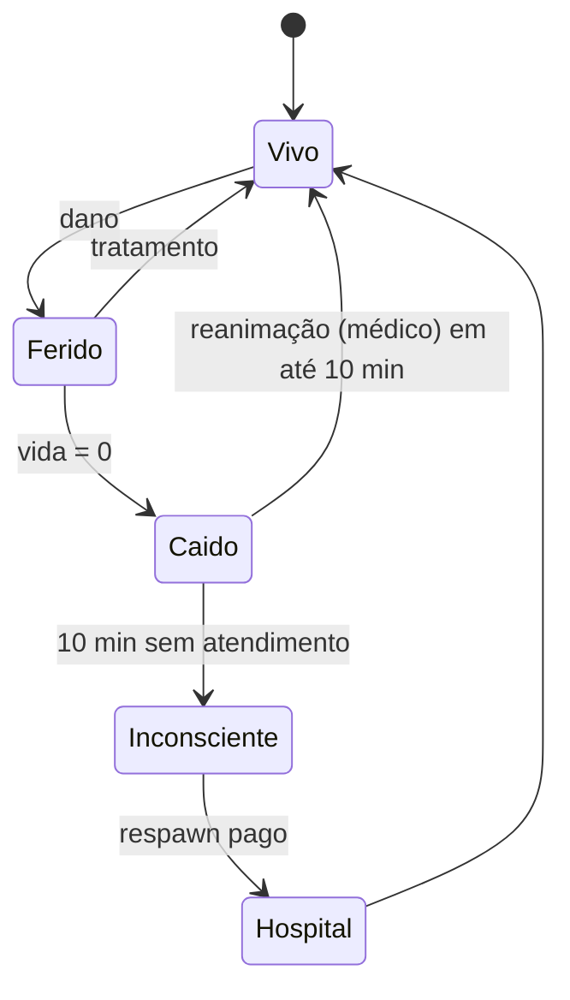

# 09 — Hospital, SAMU e Bombeiros

**Status:** APROVADO · **Versão:** 1.0 · **Dono:** Lead Dev + Direção do Hospital

---

## 1. Estrutura

| Unidade | Local | Função |
|---------|-------|--------|
| **Hospital Central da Capital** | Centro (Pillbox) | Pronto-socorro, cirurgia, internação, psiquiatria |
| **UPA Litoral Sul** | Litoral | Atendimento básico |
| **Posto de Saúde Serra Verde** | Interior | Atendimento básico, base do SAMU rural |
| **SAMU 192** | Bases móveis | Atendimento pré-hospitalar |
| **Corpo de Bombeiros 193** | Quartéis Centro e Interior | Incêndios, resgate, acidentes |

## 2. Hierarquia

Estagiário → Socorrista → Enfermeiro → Médico Residente → Médico → Especialista (Cirurgião, Psiquiatra)
→ Chefe de Plantão → Diretor Clínico → Diretor-Geral.

Ingresso: 15 h de cidade, prova (protocolos), curso prático, estágio de 7 dias.

## 3. Sistema de ferimentos

- Dano mapeado por **parte do corpo** (cabeça, tronco, braços, pernas) e **tipo** (tiro, faca, impacto, queimadura, queda).
- Efeitos: perna ferida → manca/não corre; braço → mira tremida; cabeça → visão turva; sangramento → perda de vida contínua.
- Tratamentos por item: bandagem (sangramento leve), torniquete, tala, analgésico, sutura, cirurgia (tiro no tronco).
- Diagnóstico pelo médico via interação (`ox_target`) mostrando ferimentos ao médico, **não ao paciente** (RP).

## 4. Estados de morte

| Estado | Duração | Pode | Não pode |
|--------|---------|------|----------|
| **Caído** | até 10 min | Falar baixo, chamar SAMU (botão), ser arrastado/carregado | Andar, usar itens, rádio |
| **Inconsciente** | após 10 min | Escolher respawn no hospital | — |

- **Respawn no hospital**: perde itens ilegais e dinheiro em espécie acima de R$ 1.000 (regra "amor à vida"
  configurável), paga taxa (R$ 4.000–15.000 conforme gravidade), **esquece os eventos** dos últimos 15 min (regra de RP).
- Se houver **≥ 3 médicos em serviço**, respawn só após 10 min e com chamada SAMU automática;
  se houver 0 médicos, respawn liberado após 3 min (NPC "Dr. Plantão") com taxa maior.

## 5. Atendimento e cobrança

| Procedimento | Valor (pago pelo paciente → 60% hospital/Governo, 40% bônus do médico) |
|--------------|------------------------------------------------------------------------|
| Consulta | R$ 800 |
| Reanimação no local | R$ 3.000 |
| Tratamento de tiro | R$ 6.000 |
| Cirurgia | R$ 12.000 |
| Internação (por 10 min) | R$ 2.000 |
| Atestado / exame de aptidão (CNH, porte) | R$ 1.500 |
| Avaliação psicológica (porte de arma) | R$ 2.500 |

- **Plano de saúde** (semanal: Básico R$ 3.000, Premium R$ 8.000) com descontos de 40–70%.
- Paciente sem dinheiro: dívida registrada na conta (cobrada no próximo depósito).

## 6. Prontuário (MDT médico)

- Histórico de atendimentos, alergias (RP), cirurgias, laudos, atestados.
- **Sigilo médico**: polícia só acessa com mandado judicial.
- Laudos de corpo de delito alimentam inquéritos (integração com [08-policia.md](08-policia.md)).

## 7. Bombeiros

- Incêndios dinâmicos (eventos de acidente, crimes, staff) com propagação limitada.
- Resgate em altura e aquático, desencarceramento em acidentes graves.
- Vistoria de segurança para alvará de empresas (integração com [07-empresas.md](07-empresas.md)).

## 8. Neutralidade

- Médicos e bombeiros são **neutros**: não podem ser alvo de roubo/sequestro em serviço (regra).
- Hospital é **zona segura**: proibido violência dentro e em um raio de 50 m (exceto eventos aprovados).
- Proibido ao médico em serviço participar de crimes.

## 9. Métricas

- Médicos em serviço por horário (meta: ≥ 6 em horário de pico).
- Tempo médio até atendimento de "caído".
- % de respawns sem atendimento (meta: < 30%).
