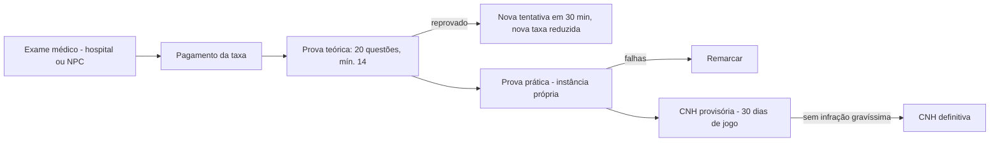

# 10 — DETRAN da Capital

**Status:** APROVADO · **Versão:** 1.0 · **Dono:** Lead Dev + Direção do DETRAN

---

## 1. Funções

1. Habilitação (CNH) — exames teóricos e práticos.
2. Registro e emplacamento de veículos (placa Mercosul).
3. IPVA, licenciamento (CRLV) e transferência de propriedade.
4. Multas, pontuação e suspensão de CNH.
5. Pátio (veículos apreendidos) e leilão.
6. Vistoria veicular.

O DETRAN funciona com **servidores jogadores** (examinadores, atendentes) e possui **modo NPC**
(totem de autoatendimento) quando não há atendente em serviço — com taxas 20% maiores e sem prova prática
acompanhada (prova prática automatizada com rota fixa).

## 2. CNH

| Categoria | Permite | Pré-requisito | Taxa | Prova prática |
|-----------|---------|---------------|------|---------------|
| **A** | Motos | — | R$ 2.500 | Circuito com cones + rota urbana |
| **B** | Carros | — | R$ 3.500 | Baliza + rota urbana com fiscalização de semáforo e velocidade |
| **C** | Caminhões leves | B há 7 dias de jogo | R$ 6.000 | Rota com carga |
| **D** | Ônibus / vans | B há 14 dias | R$ 7.000 | Linha com paradas |
| **E** | Carretas | C | R$ 9.000 | Engate + rota rodoviária |
| **Piloto (heli/avião)** | Aeronaves | Escola de aviação (empresa ou NPC) | R$ 60.000 | Voo com checkpoints |
| **Náutica** | Barcos | — | R$ 4.000 | Rota no litoral |

### Fluxo

- Prova prática em **routing bucket** próprio (sem tráfego de jogadores), com faltas automáticas:
  exceder velocidade, avançar sinal, colisão, não usar cinto.
- CNH é **item-documento** com foto, categoria, validade e pontuação, mais registro no banco.

## 3. Veículos

- **Placa Mercosul** `ABC1D23` gerada na compra (placas personalizadas = cosmético pago in-game, dreno).
- **RENAVAM** único; **CRLV** digital (no celular) ou item.
- **Transferência** entre jogadores: ambos presentes no DETRAN (ou totem), taxa de 2% do valor de tabela,
  gera registro no ledger e no histórico do veículo (evita "venda" por fora sem rastro).
- **Vistoria**: obrigatória para veículos com modificações de desempenho; veículo irregular gera multa.

## 4. IPVA e licenciamento

| Item | Regra |
|------|-------|
| IPVA | 0,5% do valor de tabela por semana real, cobrado automaticamente da conta do dono (worker semanal) |
| Atraso | Após 2 semanas em atraso: veículo aparece como "irregular" no radar ANPR → passível de apreensão |
| Licenciamento | Junto com IPVA; CRLV válido enquanto pago |
| Veículos de empresa/organização | Cobrados da conta da empresa/org |

## 5. Multas e pontos

| Gravidade | Valor | Pontos | Exemplos |
|-----------|-------|--------|----------|
| Leve | R$ 800 | 3 | Estacionar irregular, sem cinto |
| Média | R$ 1.500 | 4 | Excesso de velocidade até 20% |
| Grave | R$ 3.000 | 5 | Excesso 20–50%, avançar sinal |
| Gravíssima | R$ 6.000 | 7 | Excesso > 50%, racha, dirigir sem CNH, fuga de blitz |

- **Suspensão**: 20 pontos em 30 dias de jogo → CNH suspensa por 7 dias + curso de reciclagem (R$ 5.000).
- **Cassação**: dirigir com CNH suspensa → cassada; novo processo completo após 14 dias.
- Pontos expiram após 30 dias de jogo.
- Multas emitidas por: policiais (MDT), radares fixos (automático, para o **dono** do veículo), agentes do DETRAN.
- Multas não pagas em 14 dias: +20% e bloqueio de transferência/licenciamento.

## 6. Pátio e apreensão

- Motivos: IPVA atrasado, sem CNH, crime, estacionamento irregular, abandono (limpeza automática → pátio público).
- Liberação: R$ 1.500 + R$ 500/dia + multas pendentes, com CNH válida.
- Veículos não retirados em **21 dias** vão a **leilão** (painel web e evento in-game semanal):
  lance mínimo 40% da tabela; valor arrecadado → Governo (o dono anterior recebe 30% descontadas as dívidas).

## 7. Integrações

| Sistema | Integração |
|---------|------------|
| Polícia (MDT) | Consulta de CNH/veículo, emissão de multa, ordem de apreensão |
| Concessionárias | Emplacamento automático na compra |
| Hospital | Exame médico de aptidão |
| Banco | Cobrança automática de IPVA e multas |
| Painel web | Consulta de multas, pagamento, histórico do veículo, leilão |
