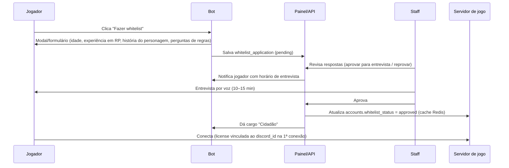

# 11 — Discord

**Status:** APROVADO · **Versão:** 1.0 · **Dono:** Head de Staff + Dev Web

---

## 1. Papel do Discord

O Discord é a **porta de entrada** (whitelist), o **canal oficial** de comunicação, o **suporte**
(tickets) e a **identidade** do jogador (login no painel via OAuth2). O jogo **não depende** do Discord
estar no ar para funcionar: dados de whitelist/cargos ficam em cache no banco/Redis.

## 2. Estrutura de canais

```
📢 INFORMAÇÕES
   #boas-vindas · #regras · #anúncios · #changelog · #status-servidor · #faq
🎫 WHITELIST
   #como-entrar · #formulário (botão do bot) · #resultado
🆘 SUPORTE
   #abrir-ticket (botão: Dúvida | Denúncia | Bug | Revisão de punição | Doação | Facção/Empresa)
   🔒 tickets privados (criados pelo bot)
💬 COMUNIDADE
   #geral · #mídia · #clips · #sugestões (fórum com votos) · #off-topic
🏙️ CIDADE (IC/OOC controlado)
   #jornal-da-capital · #classificados · #eventos
🚓 INSTITUIÇÕES (cargos)
   PMC · PCiv · Hospital · DETRAN · Justiça · Prefeitura → canais internos, #bater-ponto, #escalas
🏴 ORGANIZAÇÕES (cargos)
   canal privado por facção/empresa aprovada
🎙️ VOZ
   Sala de espera de entrevista · Entrevistas 1–5 · Eventos · Lobby
🛡️ STAFF (privado)
   #staff-chat · #alertas-anticheat · #alertas-economia · #punições · #logs-admin · #revisão-whitelist
```

## 3. Cargos

| Grupo | Cargos | Sincronização |
|-------|--------|---------------|
| Acesso | `Visitante`, `Em análise`, `Aprovado (Cidadão)`, `Suspenso` | Bot → banco → jogo |
| Instituições | `PMC`, `PCiv`, `Hospital`, `DETRAN`, `Justiça`, `Prefeitura` + patentes | **Jogo → Discord** (fonte da verdade é o jogo/painel) |
| Organizações | Um cargo por facção/empresa | Jogo → Discord |
| Apoiadores | `Apoiador Bronze/Prata/Ouro` | Tebex → bot |
| Staff | `Helper`, `Moderador`, `Admin`, `Head`, `Dev`, `Diretoria` | Manual + painel (2FA) |
| Criadores | `Streamer` | Manual |

## 4. Fluxo de whitelist



- Reprovado: pode tentar de novo após 7 dias.
- Conta Discord com menos de 30 dias → revisão extra (anti-smurf/ban evasion).
- **Vínculo license ↔ discord_id** é permanente (troca só via ticket).

## 5. Funcionalidades do bot

| Comando / função | Descrição |
|------------------|-----------|
| `/status` | Jogadores online, fila, uptime, próximo restart |
| `/perfil` | Horas jogadas, personagens (nome), data de whitelist |
| `/ponto entrar|sair` | Ponto de instituições (espelho do jogo; o jogo é a fonte) |
| `/ranking` | Horas de serviço por instituição (semanal) |
| Tickets | Criação por botão, transcrição salva no painel ao fechar, avaliação do atendimento |
| Sugestões | Fórum com votos, status (em análise / aprovada / implementada) |
| Logs para staff | **Somente resumos e alertas** (anticheat, economia, punições). Logs completos ficam no painel |
| Anúncios automáticos | Restarts, eventos, changelog (via CI após deploy) |
| Sincronização de bans | Ban no painel → kick do Discord opcional + bloqueio no jogo |

## 6. Arquitetura do bot

- **discord.js v14**, TypeScript, processo próprio (`apps/discord-bot`), *sharding* não necessário (1 servidor).
- Fala com o jogo **só via Redis** (`spc:cmd`/`spc:evt`) e com o banco via API interna.
- **Nada de webhooks direto do servidor de jogo** para o Discord: com 500 jogadores, webhooks estouram rate
  limit e travam threads. O jogo publica eventos; o bot agrega e envia.
- Fila de envio com respeito ao rate limit do Discord e *retry* exponencial.

## 7. Moderação

- AutoMod do Discord + filtro de palavras.
- Ponte de punições: advertências e bans do Discord e do jogo ficam no mesmo histórico (`warnings`, `bans`).
- Revisão de punição: ticket específico, analisado por staff diferente de quem aplicou.
