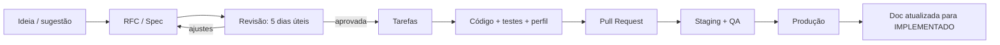

# 13 — Processo de Desenvolvimento

**Status:** APROVADO · **Versão:** 1.0 · **Dono:** CTO

---

## 1. Documentation-first



- **RFC** (`docs/rfcs/NNNN-titulo.md`): mudanças grandes, novos sistemas, mudanças de economia/regras.
- **ADR** (`docs/adr/NNNN-titulo.md`): decisões técnicas (contexto, decisão, consequências).
- **Spec** (`docs/specs/<sistema>.md`): detalhe de implementação de um sistema aprovado.

## 2. Template de spec

```markdown
# Spec: <Sistema>
Status · Versão · Dono · Revisores

## Objetivo de RP e de produto
## Fora de escopo
## Fluxos (passo a passo + diagrama)
## Dados (tabelas/colunas novas ou alteradas + migração)
## Eventos e callbacks (nome, direção, payload, validações server-side)
## Exports públicos (API para outros recursos)
## Economia (fontes, drenos, valores — aprovado pelo designer de economia)
## Segurança (como um cheater tentaria abusar e como bloqueamos)
## Performance (orçamento, loops, frequência de salvamento)
## Logs gerados
## UI/NUI (wireframe)
## Critérios de aceite (testáveis)
## Plano de rollout e rollback
```

## 3. Padrões de código

| Área | Padrão |
|------|--------|
| Lua | Lua 5.4 (`lua54 'yes'`), `ox_lib`, sem globais, módulos `require`, *lint* com `luacheck`/`lua-language-server` |
| TypeScript | `strict`, ESLint + Prettier, Zod em toda entrada externa |
| SQL | Apenas parametrizado; migrações versionadas; revisão do DBA para índices |
| Eventos | Nome `spc_<recurso>:<server|client>:<ação>`; toda entrada validada no servidor |
| Configuração | Valores de balanceamento em `config`/JSON compartilhado, nunca *hardcoded* |
| Segredos | Nunca no repositório. CI com *secret scanning* bloqueando o PR |
| Commits | Conventional Commits (`feat(police): ...`) |
| Branches | `main` protegida; PR com 1 revisão (2 para `spc_core`, economia e segurança) |

## 4. Definition of Done

- [ ] Spec `APROVADA` e linkada no PR
- [ ] Código revisado e aprovado
- [ ] Testes automatizados (unidade para lógica pura; integração para ledger/banco)
- [ ] Relatório de perfil (`resmon`/`profiler`) dentro do orçamento
- [ ] Checklist de segurança da spec verificado
- [ ] Logs implementados
- [ ] Testado em `staging` por QA
- [ ] Documentação atualizada (doc do sistema + changelog público)

## 5. Testes

| Tipo | Ferramenta | Alvo |
|------|-----------|------|
| Unidade (Lua) | busted | Cálculos (pena, imposto, preço dinâmico) |
| Unidade (TS) | Vitest | API, bot |
| Integração | Testcontainers (MariaDB/Redis) | Ledger, transações, migrações |
| E2E painel | Playwright | Fluxos críticos (login, pagar multa, ban) |
| Carga | k6 + playtests escalonados | API/DB a 700 CCU; jogo 64→512 |
| Regressão de jogo | Checklist de QA por release | Sistemas P0 |

## 6. Releases

- Janela de deploy nos restarts programados; *hotfix* fora da janela só para segurança/crash.
- Versão semântica por pacote; changelog gerado e anunciado pelo bot.
- *Feature flags* para ativar sistemas novos gradualmente (ex.: só para staff, depois 10%, depois todos).

## 7. Andamento

| Item | Estado |
|------|--------|
| Documentos 00–13 aprovados | ✅ 2026-11-10 |
| Código Penal e Regulamento Geral | ✅ [publico/](publico/) |
| ADRs 0001–0010 | ✅ [adr/](adr/README.md) |
| Specs P0: `spc_core`, ledger, logs/ponte, whitelist/fila | ✅ [specs/](specs/) |
| Infra `dev` (docker-compose) e CI (`.github/workflows/spc-ci.yml`) | ✅ |
| **Fase 1 — incremento 1:** `spc_core`, ledger, `spc_logs`, `spc_bridge`, migrações | ✅ código + testes |
| Specs P0: `spc_multichar`, inventário, HUD, `spc_admin`, API e bot de whitelist | ✅ [specs/](specs/) |
| **Fase 1 — incremento 2:** inventário, `spc_admin`, `spc_multichar`, `spc_hud`, API, bot | ✅ código + testes |
| Specs P1 da Fase 2: necessidades, banco/caixas, veículos/garagens, DETRAN, hospital, polícia (MDT), celular | ⏳ próximo |
| Primeiro boot em FXServer de `staging` (64 slots) | ⏳ próximo |
