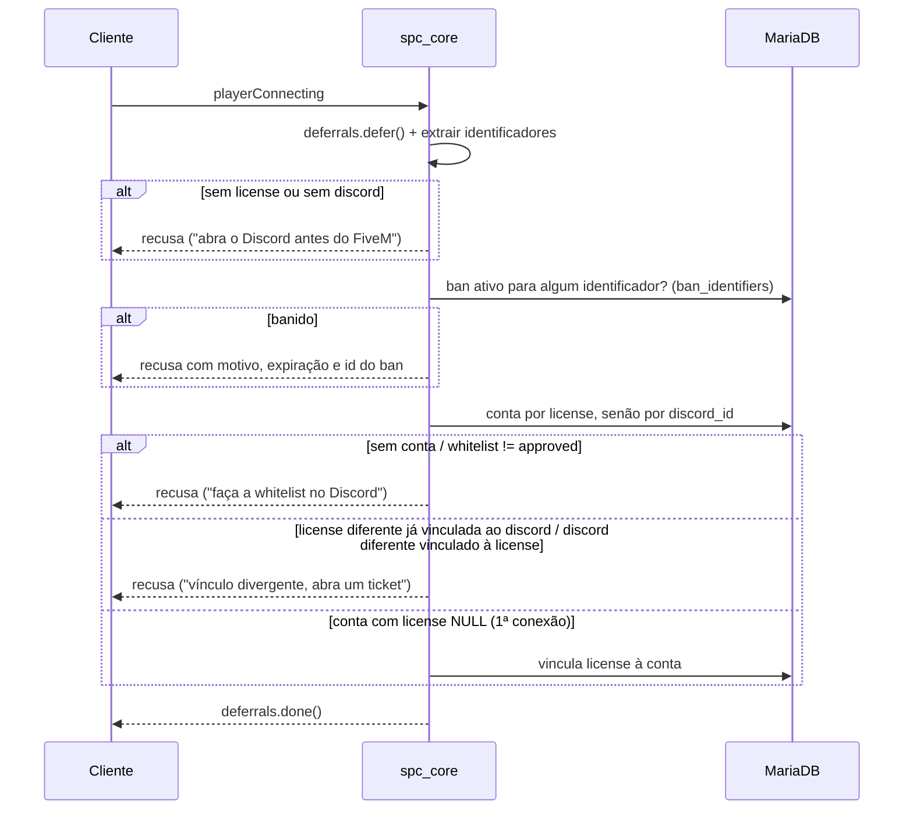

# Spec: `spc_core` — Contas, Conexão, Personagens e Permissões

**Status:** APROVADO · **Versão:** 1.0 · **Dono:** Lead Dev · **Revisores:** CTO, DBA
**Fase:** F1 (Fundação) · **Prioridade:** P0

## 1. Objetivo

Ser a autoridade do servidor sobre **quem é o jogador** (conta), **quem é o personagem** e **o que ele pode
fazer** (permissões). Todos os outros recursos consultam o `spc_core` por exports; nenhum acessa as tabelas
`accounts`/`characters` diretamente.

## 2. Fora de escopo (specs próprias)

- Interface de seleção/criação de personagem (`spc_multichar`, NUI). Enquanto não existir, há comandos
  de desenvolvimento habilitados apenas com a convar `spc_dev 1`.
- Fila com prioridade (`spc_queue`) — ver [fila-whitelist.md](fila-whitelist.md).
- Aparência, inventário inicial, HUD.

## 3. Conexão (`playerConnecting`)

- Identificadores obrigatórios: `license:` e `discord:`. Também guardados (para ban): `fivem:`, `steam:`, `license2:`.
  IP **não** é usado para ban automático (CGNAT no Brasil gera falsos positivos).
- A conta é criada **pelo processo de whitelist** (bot/painel), com `discord_id` e `license` NULL.
  A primeira conexão vincula a license.
- Toda decisão fica em cache por license até o `playerJoining` (máx. 120 s) para mapear o `source` definitivo.
- Recusas são logadas (`connection.refused`, com motivo).

## 4. Personagens

### 4.1 Callbacks (cliente → servidor, via `lib.callback`)

| Nome | Entrada | Saída | Rate limit |
|------|---------|-------|------------|
| `spc_core:characters:list` | — | lista `{citizenid, firstName, lastName, birthdate, gender}` | 1/s |
| `spc_core:characters:create` | `{firstName, lastName, birthdate, gender, nationality}` | `{ok, citizenid | error}` | 1/5 s |
| `spc_core:characters:select` | `citizenid` | `{ok, error?}` | 1/2 s |

### 4.2 Regras de criação

| Campo | Regra |
|-------|-------|
| Nome / sobrenome | 2–20 caracteres; letras (incluindo acentos latinos), espaço, hífen, apóstrofo; sem palavras da lista bloqueada; capitalização normalizada |
| Nascimento | `AAAA-MM-DD` válido; idade entre 18 e 90 anos na data do servidor |
| Gênero | `m`, `f`, `x` |
| Nacionalidade | Lista fechada na config (padrão: `Brasileira`) |
| Slots | `accounts.char_slots` (padrão 2); personagens com `deleted_at`/`ck_at` não contam |

Gerados pelo servidor (com até 5 tentativas em caso de colisão de chave única):
- `citizenid`: `SPC` + 5 caracteres base36 maiúsculos.
- `cpf`: formato `000.000.000-00` com **dígitos verificadores propositalmente inválidos pela regra real**
  (o primeiro DV é deslocado em +1 mod 10). Isso garante que nenhum CPF do jogo coincida com um CPF real
  válido. O jogo valida com a sua própria regra (`Identity.isGameCpf`).
- `rg`: `00.000.000-0`.
- `phone_number`: `(11) 9XXXX-XXXX`.

Na criação, na mesma sequência: insere o personagem → cria conta corrente no Banco Capital →
transfere o **dinheiro inicial** (R$ 5.000) de `MINT_STARTER` com motivo `starter.grant`
(via ledger — ver [ledger.md](ledger.md)). Itens iniciais ficam para a spec do inventário.

### 4.3 Seleção e sessão

- Só personagens da própria conta, não deletados e sem CK.
- Um personagem por `source`; trocar exige reconectar (P0).
- Ao selecionar: carrega em memória, define *state bags* replicados
  `citizenid`, `name` e `loaded = true`; dispara o evento servidor `spc_core:server:characterLoaded(src, citizenid)`
  e o evento cliente `spc_core:client:characterLoaded(spawnData)`.
- Personagem com `jail_minutes > 0` é marcado para o sistema prisional (`state.jailMinutes`).

### 4.4 Persistência

| Dado | Quando |
|------|--------|
| Posição (lida no servidor com OneSync, nunca enviada pelo cliente) | A cada 5 min (lote) e no `playerDropped` |
| Status (fome, sede, stress) | A cada 5 min, lido do *state bag* `status` que só o servidor escreve |
| Tempo de jogo | No `playerDropped` (`accounts.playtime_minutes`) |
| Dinheiro / itens | Imediato, pelos respectivos sistemas |

O salvamento em lote é **escalonado**: os jogadores são divididos em lotes de 25 com 1 s entre lotes, para
não concentrar 500 queries num único tick.

## 5. Permissões

- Papéis de staff (tabela `staff`), com herança: `helper < mod < admin < head < dev < owner`.
- Cada papel tem uma lista de permissões (config). Curinga `*` só para `owner`.
- `HasPermission(src, 'players.kick')` verifica no cache em memória; console do servidor (`src == 0`) tem todas.
- Permissões de emprego/facção serão adicionadas pelos respectivos sistemas através de *providers*
  registrados no core (`RegisterPermissionProvider(fn)`), para o core não conhecer regras de cada sistema.

## 6. Exports (servidor)

| Export | Retorno |
|--------|---------|
| `GetPlayer(src)` | Cópia somente leitura `{source, accountId, license, discordId, staffRole, character}` ou `nil` |
| `GetSourceByCitizenId(citizenid)` | `source` ou `nil` |
| `HasPermission(src, perm)` | `boolean` |
| `GetBankAccountId(src)` | `id` da conta corrente do personagem ativo |
| `RegisterPermissionProvider(fn)` | — |
| Exports de dinheiro | Ver [ledger.md](ledger.md) |

## 7. Comandos externos (via `spc_bridge`)

| Tipo | Payload | Ação |
|------|---------|------|
| `player.kick` | `{license? , citizenid?, reason}` | Derruba o jogador com o motivo |
| `account.refresh` | `{discordId}` | Invalida o cache de whitelist/staff/ban da conta e derruba se não for mais aprovada |

## 8. Segurança

| Abuso | Bloqueio |
|-------|----------|
| Selecionar personagem de outra conta | Validação de `account_id` no servidor |
| Criar personagens em massa | Rate limit + limite de slots |
| Nomes ofensivos / de celebridades | Lista bloqueada + revisão via painel |
| Teleporte via posição salva | Posição lida só no servidor |
| Chamar callbacks antes de carregar | Todos os callbacks verificam o estado da sessão |
| Burlar ban trocando de conta Discord | Ban por todos os identificadores + revisão de contas Discord com < 30 dias (bot) |

## 9. Performance

- Nenhum loop por tick. Um único *thread* de salvamento a cada 5 min.
- Login: até 3 queries (ban, conta, personagens), todas indexadas.
- Orçamento: < 0,1 ms médio no servidor; 0 ms no cliente quando idle.

## 10. Logs

`connection.accepted`, `connection.refused`, `character.created`, `character.selected`,
`player.dropped` (com motivo e tempo de sessão), `permission.denied`.

## 11. Critérios de aceite

1. Conta sem whitelist é recusada com mensagem clara.
2. Conta banida por qualquer identificador é recusada, mostrando o id do ban.
3. Primeira conexão vincula a license; conexão com license divergente é recusada.
4. Criação respeita todas as regras da seção 4.2 e cria conta bancária com R$ 5.000 via ledger.
5. Não é possível selecionar personagem de outra conta.
6. Posição e status persistem após reconectar.
7. Testes automatizados de `Identity`, `RateLimit` e `Permissions` passam.
